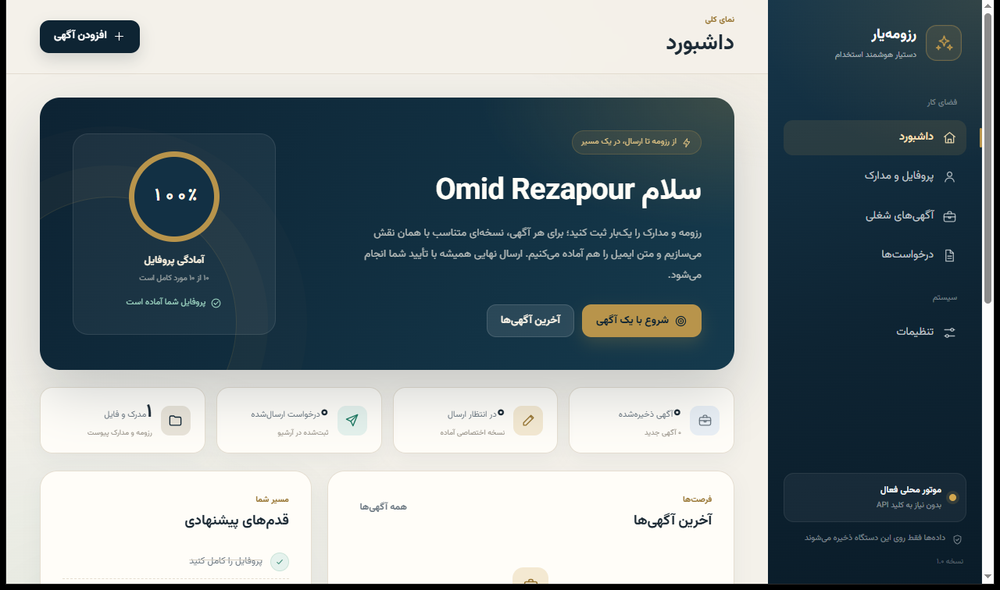

# ResumeYar

-orange)


A local-first job-search assistant with a Persian-first interface. It keeps your profile and CV in one place, imports a job posting, scores the match, generates a tailored CV and cover letter, and tracks every application.

> **Work in progress.** This is a personal project under active development, not a finished product. The feature list below states what works today, what is still rough, and what is planned. Interfaces and database schema may change between versions.

رزومه‌یار: دستیار جست‌وجوی کار با رابط فارسی که همه‌چیز را روی سیستم خودتان نگه می‌دارد.



## Status

| Area | State |
|---|---|
| Profile and CV upload (PDF, DOCX, TXT) | Working |
| Job import from a URL and match scoring | Working |
| Tailored CV PDF and cover letter | Working |
| Application tracker with statuses and notes | Working |
| Optional email sending through SMTP | Working, needs your own account |
| AI rewriting through an OpenAI-compatible API | Working, off by default, needs your own key |
| Windows desktop app (PyInstaller) | Working |
| Windows installer (Inno Setup) | Working, built but not yet run on a clean machine |
| Automated tests | Not started |
| Tested on browsers other than Chrome | Not started |

## Features

- **Profile** with experiences, education, skills, links and job preferences.
- **CV upload and parsing** into structured profile fields, with a manual edit path for everything the parser gets wrong.
- **Job capture**: paste a posting URL or the raw text; the app extracts title, company, requirements and language.
- **Match analysis**: keyword and skill coverage between your profile and the posting, with the gaps listed explicitly.
- **Tailored output**: a CV PDF and a cover letter generated for that specific posting, with a ZIP package for sending.
- **Application tracker**: stages, notes, generated documents, status history.
- **Persian and English content** in one profile, RTL-aware PDF output with Shaped Persian text.
- **Local storage**: SQLite and files under `data/`, nothing leaves the machine unless you enable SMTP or AI.

## Tech stack

Python 3.11+, Flask, SQLite, reportlab (PDF), pypdf, python-docx, BeautifulSoup, requests, arabic-reshaper and python-bidi (Persian shaping), optional `openai` client for any OpenAI-compatible endpoint.

## Run locally

```bash
python -m venv .venv
.venv\Scripts\activate        # Windows
# source .venv/bin/activate   # Linux / macOS
pip install -r requirements.txt
python app.py
```

The app runs on http://127.0.0.1:5533 and opens the browser automatically. Set `PORT`, `HOST`, or `RESUMEYAR_NO_BROWSER=1` to change that behaviour.

## Desktop window

`desktop/` wraps the same Flask app in a native window with pywebview and WebView2, so no browser tab is needed. The window starts the local server, stays on 127.0.0.1, opens the Windows save dialog for PDF downloads, and refuses a second instance instead of showing a blank window.

```bash
pip install -r desktop/requirements_desktop.txt
python desktop/launcher.py
```

To build the executable and the installer on Windows (PyInstaller and Inno Setup 6):

```bat
cd desktop
build_windows.bat
```

`build_windows.bat` uses the virtual environment in the repository root and writes `desktop\dist\Resumeyar\Resumeyar.exe` plus an installer when ISCC is available. See [desktop/README.md](desktop/README.md) for build details and troubleshooting.

## Data and privacy

- Everything lives in `data/`: `resumeyar.db`, uploaded files, generated PDFs, and `secret.key` for the session signer.
- `data/` is git-ignored. Nothing in this repository contains a real CV, key or password.
- AI and SMTP credentials are entered in the settings page and stored only in the local database.
- The Flask development server is used as-is. Do not expose it to the internet without a WSGI server and TLS.

## Known issues

- No test suite and no CI yet; regressions in the PDF pipeline are caught by hand.
- Most functions are untyped and there is no structured logging.
- The CV parser is heuristic and works best on single-column layouts.
- Only the single-user local mode exists; no accounts, no server deployment.
- Job import depends on the target page's HTML and can break when a site changes.

## Roadmap

See [ROADMAP.md](ROADMAP.md). The next step is a pytest suite for the services (parsing, matching, PDF) plus CI; the Windows desktop build and installer are in `desktop/`.

## License

MIT, see [LICENSE](LICENSE).
